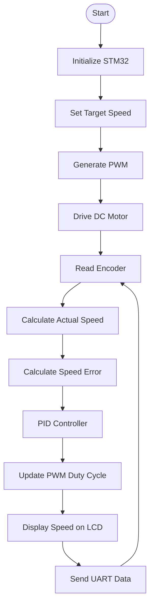

# DC Motor Speed Control Using STM32

A DC motor speed control system implemented using STM32F103C8T6, PWM, encoder feedback, and PID control.

## Project Overview

This project implements a closed-loop DC motor speed control system using the STM32F103C8T6 microcontroller.

The system uses PWM to control the motor speed and encoder feedback to measure the actual motor speed. A PID controller adjusts the PWM duty cycle based on the speed error to regulate the motor.

Motor speed information is displayed on a 16x2 LCD, while UART communication is used for serial monitoring.

## Simulation Preview

The following image shows the circuit and system running in Proteus.


## Features

- DC motor speed control using PWM
- Encoder-based speed measurement
- PID-based speed regulation
- Real-time speed display on LCD 16x2
- UART serial communication
- STM32 timer configuration for PWM and encoder mode

## Hardware Components

| Component | Description |
|---|---|
| Microcontroller | STM32F103C8T6 |
| Motor Driver | L298 |
| Motor | DC Motor with Encoder |
| Display | LCD 16x2 (LM016L) |
| Power Supply | 12V motor supply |
| Simulation | Proteus |

## Software & Development Tools

- STM32CubeIDE
- STM32CubeMX
- Proteus 8 Professional
- Embedded C
- STM32 HAL Library

## STM32 Peripheral Configuration

| Peripheral | Configuration | Function |
|---|---|---|
| TIM1 CH1 | PWM Generation | DC motor speed control |
| TIM3 | Encoder Mode (TI12) | Encoder pulse measurement |
| USART1 | 115200 baud | Serial communication |
| GPIO | Input / Output | LCD and peripheral control |

### LCD Pin Configuration

| STM32 Pin | LCD Function |
|---|---|
| PC13 | RS |
| PC14 | RW |
| PC15 | EN |
| PB12–PB15 | D4–D7 |

## System Operation

1. Initialize the STM32 peripherals.
2. Configure the PWM signal to drive the DC motor through the L298 motor driver.
3. Read encoder pulses using TIM3 encoder mode.
4. Calculate the actual motor speed.
5. Calculate the speed error between the target and actual speed.
6. Apply PID control to adjust the PWM duty cycle.
7. Display motor speed on the LCD.
8. Transmit monitoring data through UART.

## System Flowchart



## Project Structure

```text
DC-Motor-Speed-Control-STM32/
├── Core/
│   ├── Inc/
│   └── Src/
├── Drivers/
├── Images/
│   └── dc-motor-speed-control-proteus.png
├── DongCoDC.ioc
├── STM32F103C8T6_DongcoDC.pdsprj
├── STM32F103C8TX_FLASH.ld
├── .project
├── .cproject
├── .mxproject
└── README.md
```

## How to Run

### 1. Open the STM32 Project

1. Install STM32CubeIDE.
2. Open STM32CubeIDE.
3. Select **File → Import → General → Existing Projects into Workspace**.
4. Browse to the cloned repository folder.
5. Select the STM32 project and click **Finish**.

### 2. Build the Project

1. Open the project in STM32CubeIDE.
2. Select **Project → Build Project**.
3. Wait for the compilation process to finish.
4. Check the Console and Problems tabs for build errors.
5. Locate the generated firmware file in the `Debug` output directory.

### 3. Run the Proteus Simulation

1. Open Proteus 8 Professional.
2. Open `STM32F103C8T6_DongcoDC.pdsprj`.
3. Check the STM32 microcontroller properties and firmware program-file configuration.
4. Select the firmware generated by STM32CubeIDE in the format supported by the Proteus STM32 model.
5. Verify the clock frequency, power supplies, and component connections.
6. Click **Run** to start the simulation.

### 4. Observe the Results

- Observe the DC motor operation.
- Monitor the motor speed on the LCD.
- Check serial output through the UART Virtual Terminal.
- Observe how the PWM control responds to speed feedback.

## Author

**Ngo Huy**

Fourth-year Microelectronics Engineering Student  
Ho Chi Minh City University of Foreign Languages and Information Technology (HUFLIT)

**Interests:** Embedded Systems, Electronics, Microcontrollers, and Semiconductor Engineering.
