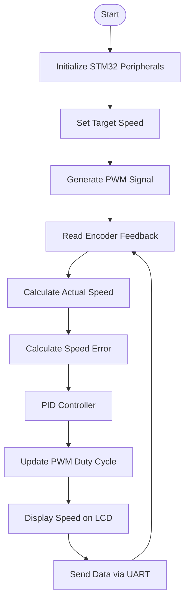

# DC Motor Speed Control Using STM32

A DC motor speed control system using STM32 microcontroller, PWM, rotary encoder feedback, and PID control.

## Project Overview

This project focuses on controlling the speed of a DC motor using an STM32 microcontroller.

The system generates a PWM signal to control motor speed and uses encoder feedback to measure the actual motor speed. A PID controller is implemented to adjust the PWM duty cycle and maintain the desired speed.

The system also displays motor speed information on an LCD and supports serial communication through UART.

## Features

- DC motor speed control using PWM
- Real-time motor speed measurement using rotary encoder
- PID-based speed control
- LCD 16x2 speed display
- UART communication for monitoring system data
- Motor speed feedback and adjustment

## Hardware Components

| Component | Description |
|---|---|
| Microcontroller | STM32F1 |
| Motor Driver | L298N |
| Motor | DC Motor with Encoder |
| Display | LCD 16x2 |
| Communication | UART Virtual Terminal |

## Software & Development Tools

- STM32CubeIDE
- STM32CubeMX
- Proteus 8 Professional
- Embedded C
- STM32 HAL Library

## STM32 Configuration

| Peripheral | Configuration | Function |
|---|---|---|
| TIM1 CH1 | PWM Mode | Motor speed control |
| TIM3 | Encoder Mode (TI12) | Read encoder signals |
| USART1 | 115200 baud | Serial communication |
| GPIO | Output/Input | Peripheral control |

### Pin Configuration

| Pin | Function |
|---|---|
| PA8 | PWM Output (TIM1 CH1) |
| PA0 / PA1 | Encoder Input (TIM3) |
| USART1 TX/RX | UART Communication |
| PC13 | LCD RS |
| PC14 | LCD RW |
| PC15 | LCD EN |
| PB12–PB15 | LCD Data Pins (D4–D7) |

## Control System

The system operates through the following process:

1. Set the desired motor speed.
2. Generate a PWM signal to drive the motor.
3. Read encoder pulses to calculate actual motor speed.
4. Compare actual speed with the target speed.
5. Apply PID control to adjust the PWM duty cycle.
6. Display speed information on the LCD.

## System Flowchart



## Project Structure

```text
DC-Motor-Speed-Control-STM32/
├── Core/
│   ├── Inc/
│   └── Src/
├── Drivers/
├── Proteus/
├── Images/
├── Documentation/
└── README.md
```

## Simulation Results

The following image shows the DC motor speed control system simulated in Proteus.


## Author

**Ngo Huy**

Fourth-year Microelectronics Engineering Student  
Ho Chi Minh City University of Foreign Languages and Information Technology (HUFLIT)
